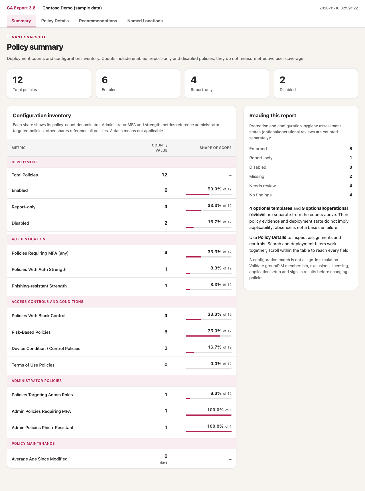
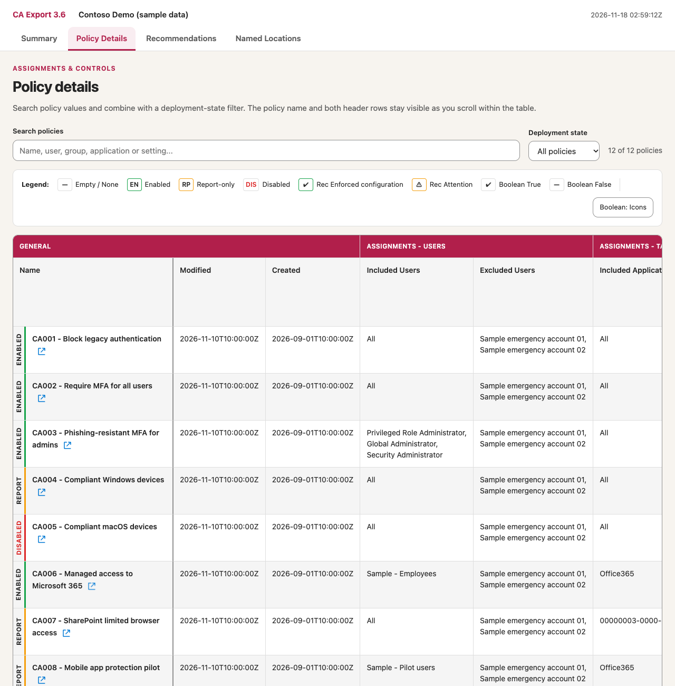
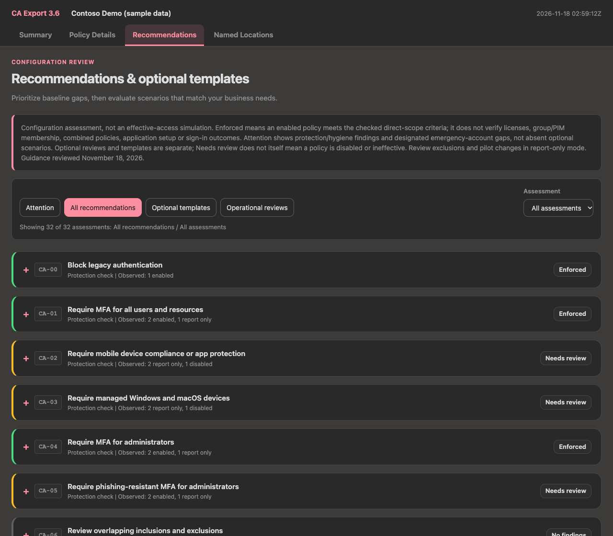
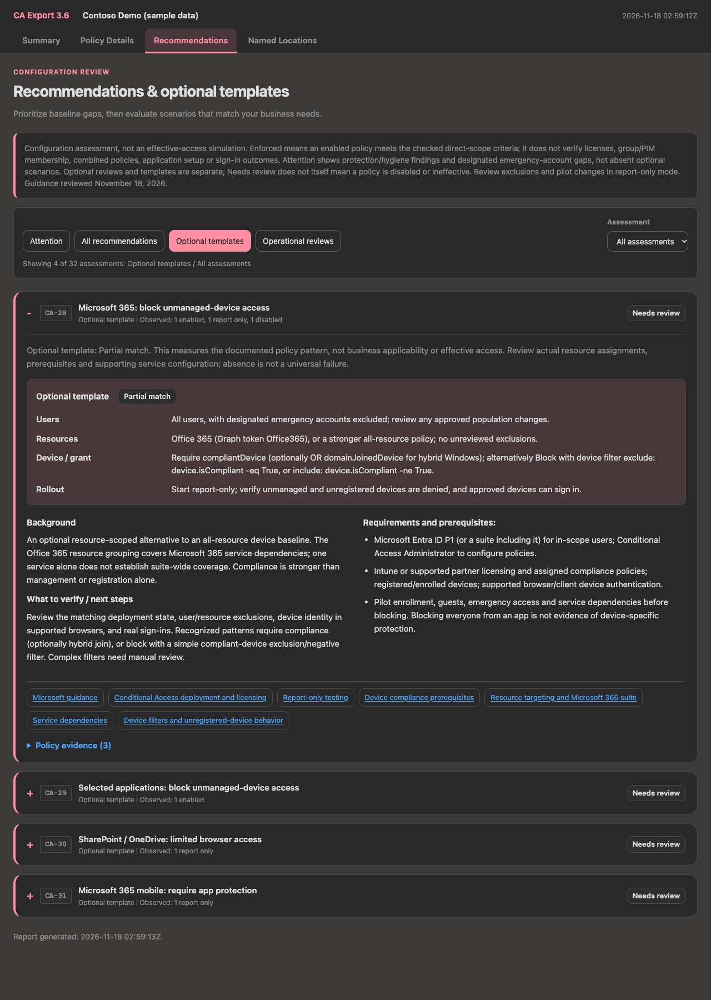
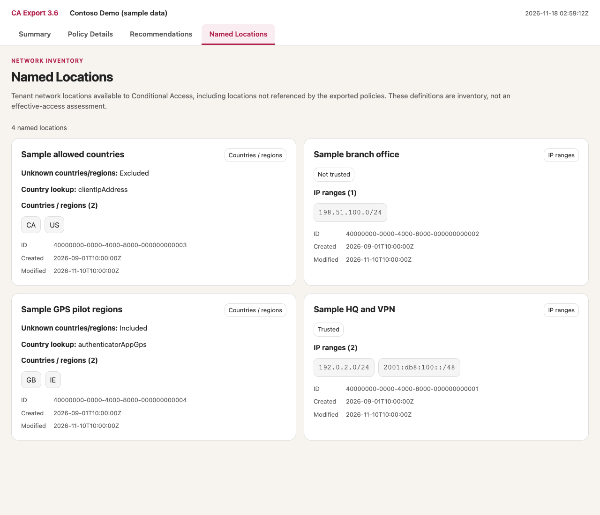

# Export Conditional Access Policies PowerShell Scripts

Export and analyze Microsoft Entra ID (Azure AD) Conditional Access (CA) policies for documentation, security review, and remediation planning.

Two scripts are provided:

| Script | Purpose |
|--------|---------|
| `Export-CaPolicy.ps1` | Lightweight export – single HTML table of policies. |
| `Export-CAPolicyWithRecs.ps1` | Full export – identity enrichment, 32 recommendation/template assessments, Named Locations, multiple output formats, and an interactive HTML report. |

---
## Key Features (Full Export Script)

* Automatic Microsoft Graph connection (Policy.Read.All, Directory.Read.All, RoleManagement.Read.All), with post-connect verification that all required scopes were granted.
* Best-effort assignment enrichment: resolves users, groups, roles (active + template/definition), named locations, and terms of use; unresolved values retain their original IDs.
* Offline mode (`-RawInputFile <policies-raw.json>`): regenerate reports and assessments from a raw Microsoft Graph policy array without signing in or making Graph calls. See [saving a raw snapshot](#saving-a-raw-snapshot).

* Interactive HTML report with tabbed layout:
	* Summary (deployment metric cards, categorized inventory table with aligned values, percentage bars and explicit denominators, assessment snapshot)
	* Policy Details (combined search/state filters, visible row count, contained scrolling with sticky names and two-row headers)
	* Recommendations (32 assessments, four purpose-based views, a separate assessment dropdown, prerequisites, background, Microsoft links, and policy evidence)
	* Named Locations (all tenant definitions, IPv4/IPv6 ranges, trusted flags, countries/regions, unknown-area handling, lookup method, IDs and timestamps)
* Consistent spacing, readable typography, responsive cards/navigation, and automatic light/dark styling across all tabs (`?scoutTheme=light` or `?scoutTheme=dark` overrides the system theme)
* Exact include/exclude overlap assessment with matching policy evidence
* Authentication-strength assessment uses known built-in IDs or verified method combinations, not display-name guesses
* Enhanced admin role detection: resolves active roles, template IDs, and role definition IDs (GUID → name) before MFA checks
* Legend / utility bar with deployment badges and a boolean display toggle
* Boolean display toggle (icons ✔/— or text True/False)
* Description clamp (expand/collapse with accessible aria attributes)
* Per‑policy original vs mutated JSON toggle + Copy JSON button (clipboard)
* Preference persistence (remembers active tab, boolean mode, policy deployment filter, recommendation view and assessment filter)
* Accessibility: keyboard‑navigable tabs, aria-live announcements (copy feedback), sticky headers, focusable controls
* CSV (long), CSV Pivot (wide) and JSON export options
* Deployment, authentication, device, risk, and administrator metrics in Summary
* Optional fast mode: `-NoRecommendations` skips assessments and omits the Recommendations tab; Summary, Policy Details, and Named Locations remain available
* Inline recommendation catalog (no external data file dependency) with escaped policy evidence

## Screenshots — sample data only

These captures show version 3.6 using **Contoso Demo (sample data)**. All tenant-specific information was generated from scratch with mocked Graph responses, not copied or anonymized from a real tenant. Account/group names and customer-specific IDs are fictional; network prefixes are reserved documentation ranges. Built-in Microsoft resource/role identifiers are public constants.

The sample policies illustrate report behavior, **not a recommended production baseline**. Both light and dark themes are shown.

<details open>
<summary><strong>Summary</strong> — deployment cards, grouped inventory, and assessment counts</summary>



</details>

<details>
<summary><strong>Policy Details</strong> — sample assignments, deployment tags, and contained table scrolling</summary>



</details>

<details>
<summary><strong>Recommendations</strong> — four purpose-based views and the separate Assessment dropdown</summary>



</details>

<details>
<summary><strong>Optional templates</strong> — expanded Microsoft 365 unmanaged-device guidance and prerequisites</summary>



</details>

<details>
<summary><strong>Named Locations</strong> — sample IPv4/IPv6 ranges, trust settings, and countries/regions</summary>



</details>

---
## Installation / Prereqs

PowerShell 7.5 + is recommended. Ensure Microsoft Graph modules are installed. You can install all of the modules using:

```powershell
Install-Module Microsoft.Graph -Scope CurrentUser
```

To target only the required Microsoft Graph modules, you can specify them individually:

```powershell
Install-Module Microsoft.Graph.Authentication -Scope CurrentUser
Install-Module Microsoft.Graph.Users -Scope CurrentUser
Install-Module Microsoft.Graph.Groups -Scope CurrentUser
Install-Module Microsoft.Graph.Identity.DirectoryManagement -Scope CurrentUser
Install-Module Microsoft.Graph.Identity.SignIns -Scope CurrentUser
Install-Module Microsoft.Graph.Identity.Governance -Scope CurrentUser
Install-Module Microsoft.Graph.DeviceManagement.Enrollment -Scope CurrentUser
```

When the script runs it will request admin consent to allow it to use the Microsoft Graph command line tools, if this not already granted. If you do not have permission to grant admin consent, you will need to work with your Entra ID administrator to obtain the necessary permissions.

After sign-in or reconnection, the script reads the new Graph context and stops if the authenticated account or any required scope is missing. This verifies granted scopes, not the account's Entra role or access to every individual resource; API failures still surface separately.

---
## Quick Start

```powershell
# Basic full export (now defaults to HTML + JSON + CSV)
./Export-CAPolicyWithRecs.ps1

# All formats
./Export-CAPolicyWithRecs.ps1 -Html -Json -Csv -CsvPivot

# Identify designated emergency accounts for exclusion review (object IDs, not account names)
./Export-CAPolicyWithRecs.ps1 -Html -EmergencyAccessAccountId `
  '11111111-2222-3333-4444-555555555555','66666666-7777-8888-9999-000000000000'

# Single policy by Id (also export JSON)
./Export-CAPolicyWithRecs.ps1 -PolicyID 11111111-2222-3333-4444-555555555555 -Json

# Custom CSV columns
./Export-CAPolicyWithRecs.ps1 -Csv -CsvColumns Name,Status,'Require MFA','Block'

# Fast export (skip recommendations & omit tab)
./Export-CAPolicyWithRecs.ps1 -NoRecommendations

# Offline (use a raw Graph policy snapshot; see the snapshot example below)
#   - Skips Graph connection & enrichment queries
#   - Still evaluates recommendations on provided raw policy array
./Export-CAPolicyWithRecs.ps1 -RawInputFile .\policies-raw.json -Html -Json -NoBrowser
```

**Output files are timestamped:**
- Full script: `CAExportRecs_<TenantName>_YYYYMMDD_HHMMSS.*`
- Lightweight script: `CAExport_<TenantName>_YYYYMMDD_HHMMSS.*`

---
## Parameters (Full Script)

| Parameter | Type | Description |
|-----------|------|-------------|
| `PolicyID` | String (GUID) | Limit export to a single CA policy. |
| `Html` | Switch | Emit interactive HTML. With no export switches, HTML, JSON, and CSV are produced. |
| `NoBrowser` | Switch | Generate HTML without automatically launching browser. |
| `OutputPath` | String | Custom output directory path (defaults to current directory). |
| `Json` | Switch | Emit enriched policy JSON. This is not a raw Graph snapshot. |
| `Csv` | Switch | Emit flattened CSV of policies. |
| `CsvPivot` | Switch | Emit pivot‑friendly wide CSV. |
| `CsvColumns` | String[] | Custom column subset/order for `-Csv`. |
| `NoRecommendations` | Switch | Skip recommendation analysis & omit Recommendations tab (improves runtime in large tenants). |
| `RawInputFile` | String (path) | Read a raw Graph policy object array (offline mode). Skips Graph authentication and enrichment; assessments use the supplied snapshot. |
| `EmergencyAccessAccountId` | String[] (GUIDs) | Explicitly designated emergency-account object IDs for exclusion review. No account names or membership are guessed. |

If no export switch is specified, HTML, JSON, and CSV are produced automatically (pivot remains opt-in).

## Named Locations

Connected HTML exports retrieve the complete tenant inventory with Graph pagination, including locations not referenced by the exported policies. The same inventory resolves policy location IDs without extra per-location queries. JSON/CSV-only exports retain their existing referenced-location enrichment.

The Named Locations tab distinguishes an empty tenant inventory from retrieval failure. Offline policy snapshots do not contain location definitions, so the tab explicitly reports that the inventory is unavailable instead of claiming no locations exist. Location definitions do not change recommendation assessments or prove effective network access.

Background and permissions: [Microsoft Entra network assignments](https://learn.microsoft.com/en-us/entra/identity/conditional-access/concept-assignment-network) and [Microsoft Graph list namedLocations](https://learn.microsoft.com/en-us/graph/api/conditionalaccessroot-list-namedlocations?view=graph-rest-1.0).

---
## Recommendation Checks

Each recommendation includes background, verification/remediation steps, requirements, Microsoft documentation links, and matching policy evidence with deployment state and scope limitations.

| Checks | Assessment area |
|--------|-----------------|
| CA-00 to CA-05 | Legacy authentication; all-user MFA; mobile compliance/app protection; Windows/macOS compliance; administrator MFA and phishing-resistant MFA |
| CA-06 to CA-08 | Exact include/exclude overlaps, empty identity assignments, and direct-user assignment review |
| CA-09 | Medium/high sign-in risk, MFA/authentication strength, and every-time reauthentication |
| CA-10 to CA-12 | Device-code flow, MFA for device registration/join, and unsupported-platform blocking |
| CA-13 | MFA/authentication strength for security-information registration (distinct from device registration) |
| CA-14 | High-user-risk remediation; legacy password-change policies flagged for separate review |
| CA-15 to CA-18 | Managed administrator devices; guest/external-user MFA; Microsoft admin portal and Azure management MFA |
| CA-19 | Migration from the legacy approved-client-app grant to app protection |
| CA-20 to CA-22 | Unmanaged-device restrictions, browser/session controls, and designated emergency-access exclusions |
| CA-23 to CA-27 | Token protection, workload identities, Purview insider risk, autonomous/high-risk agents, and delegated agent access |
| CA-28 | Optional Microsoft 365 unmanaged-device blocking template: compliance grants or recognized compliant-device block filters |
| CA-29 | Optional device restrictions for explicitly selected resource applications, with actual application IDs shown in evidence |
| CA-30 | Optional SharePoint/OneDrive limited browser access template; application-side restrictions and companion client policies require verification |
| CA-31 | Optional Microsoft 365 Android/iOS app-protection template, distinct from full device enrollment/blocking |

**Assessment states:** `Enforced`, `Report-only`, `Disabled`, `Missing`, `Needs review`, and `No findings` (configuration hygiene only). Only an enabled policy meeting the checked grant and direct-scope criteria receives `Enforced`. An MFA **OR** compliant-device policy does not prove mandatory MFA. Broad all-resource MFA can satisfy guest, administrator, portal, and Azure management checks without duplicate policies. Empty Graph SDK containers are ignored; explicit all-platform/all-location assignments without exclusions are not restrictive conditions.

**Attention** includes protection/hygiene findings and gaps for explicitly designated emergency accounts, not absent optional scenarios. Optional templates and optional/operational reviews have their own filters and are counted separately from baseline states in Summary. Cards show observed enabled/report-only/disabled policy counts even when exclusions or scope still need review; `Needs review` does not mean a policy is disabled or ineffective.

The Recommendations toolbar has four views: **Attention** (the default for new preferences), **All recommendations**, **Optional templates**, and **Operational reviews**. A separate **Assessment** dropdown optionally narrows the selected view; deployment-state filters remain in Policy Details. The visible count and empty-state message explain combined filters. Saved view/assessment choices persist, and previous status-button preferences migrate to the dropdown.

This is a **configuration assessment, not an effective-access simulation or compliance certification**. Group/PIM membership, cross-tenant trust, combined coverage across multiple scoped policies, licensing, supporting application configuration, and actual sign-in outcomes are not verified. Exclusions other than supplied emergency-account IDs, restrictive/unknown conditions, and incomplete strength metadata yield `Needs review`. A `-PolicyID` export marks all recommendations `Needs review` because it is not a tenant-wide snapshot. Offline results describe only the supplied snapshot.

Optional/business-specific controls (device-code dependencies, unmanaged-device restrictions, sessions, token protection, workloads, insider risk, and agents) stay `Needs review`, with observed evidence where available, rather than becoming universal failures. Agent policy coverage cannot be certified from the v1.0 export; delegated-agent use cannot be inferred from ordinary user MFA policies.

### Optional application templates

Use the **Optional templates** filter to inspect intended users, resources, conditions, grants/session controls, rollout guidance, requirements, and Microsoft references. Each template separately reports `Matching policy enabled`, `Matching policy report-only`, `Matching policy disabled`, `Partial match`, or `Not observed`. These are policy-pattern measurements, not applicability decisions or effective-access certifications. No policies are created or changed.

The Microsoft 365 template recognizes the `Office365` resource grouping or a stronger all-resource policy; SharePoint-only protection is not suite-wide protection. The selected-app template inventories explicit assignments rather than guessing which business apps should be covered. Resource exclusions, dynamic application filters, scoped users/conditions, and grant bypasses remain visible as partial matches.

Device restrictions recognize mandatory compliance (optionally hybrid join), or Block with a simple `exclude: device.isCompliant -eq True` / `include: device.isCompliant -ne True` filter. Complex filters require review. `isManaged` or device registration alone is not compliance; `isCompliant -eq False` does not cover null attributes on unregistered devices. A blanket application block without a device condition is not identified as a device-restriction template.

SharePoint limited-access measurements detect the Conditional Access session setting only: verify tenant/site settings, download/print/sync behavior, and companion non-browser/legacy-client restrictions separately. Mobile app protection requires assigned Intune policies and supported apps/brokers; it can allow approved personal devices rather than denying every unmanaged device.

### Prerequisites and reference guidance

| Area | Requirements and background |
|------|-----------------------------|
| General Conditional Access | [Entra ID P1 or an eligible suite, appropriate roles, and staged deployment](https://learn.microsoft.com/en-us/entra/identity/conditional-access/overview). Start changes in [report-only mode](https://learn.microsoft.com/en-us/entra/identity/conditional-access/concept-conditional-access-report-only). Export permissions are not deployment permissions. |
| MFA and registration | Register supported methods and plan bootstrap/recovery. Review [authentication strengths](https://learn.microsoft.com/en-us/entra/identity/authentication/concept-authentication-strengths), [security-information registration](https://learn.microsoft.com/en-us/entra/identity/conditional-access/policy-all-users-security-info-registration), and [Temporary Access Pass](https://learn.microsoft.com/en-us/entra/identity/authentication/howto-authentication-temporary-access-pass). |
| Risk | Entra ID P2 and ID Protection signals. See [sign-in risk](https://learn.microsoft.com/en-us/entra/identity/conditional-access/policy-risk-based-sign-in) and [user-risk remediation](https://learn.microsoft.com/en-us/entra/identity/conditional-access/policy-risk-based-user). Modern `riskRemediation` requires authentication strength with AND and every-time reauthentication. Legacy password-change remediation also needs applicable SSPR/password-writeback setup. SDK/API versions can omit newer controls; unknown values need review. |
| Devices and mobile apps | Appropriate Intune or supported partner licensing plus deployed [compliance policies](https://learn.microsoft.com/en-us/intune/intune-service/protect/device-compliance-get-started) or [app-protection policies](https://learn.microsoft.com/en-us/intune/intune-service/apps/app-protection-policy). Hybrid join does not apply to macOS. [Approved-client-app migration](https://learn.microsoft.com/en-us/entra/identity/conditional-access/migrate-approved-client-app): the control became read-only June 30, 2026; existing enabled policies still enforce. |
| Application-scoped device restrictions | Choose [resource applications or the Microsoft 365 suite](https://learn.microsoft.com/en-us/entra/identity/conditional-access/concept-conditional-access-cloud-apps#office-365), verify [service dependencies](https://learn.microsoft.com/en-us/entra/identity/conditional-access/service-dependencies), and understand [device-filter null/unregistered behavior](https://learn.microsoft.com/en-us/entra/identity/conditional-access/concept-condition-filters-for-devices). Pilot enrollment, guests and emergency recovery before blocking. |
| SharePoint limited browser access | [Configure SharePoint tenant/site unmanaged-device controls](https://learn.microsoft.com/en-us/sharepoint/control-access-from-unmanaged-devices), with appropriate SharePoint/Entra licensing, SharePoint Administrator, supported clients and companion non-browser restrictions. A session-control flag does not verify application-side restrictions. |
| Guests | Review applicable External ID licensing/billing and [cross-tenant MFA/device trust](https://learn.microsoft.com/en-us/entra/external-id/cross-tenant-access-overview). |
| Emergency access | Supply designated IDs, then independently verify at least two accounts, resilient authentication, monitoring, and recovery tests. Follow [Microsoft emergency-access guidance](https://learn.microsoft.com/en-us/entra/identity/role-based-access-control/security-emergency-access). Missing direct exclusions require targeting/membership review, not automatic changes. |
| Token protection | P1 and supported devices, clients and resources; review the [support matrix and platform deployment guides](https://learn.microsoft.com/en-us/entra/identity/conditional-access/concept-token-protection), including Apple SSO/MDM and web-preview limitations. |
| Workload identities | [Workload ID Premium](https://learn.microsoft.com/en-us/entra/identity/conditional-access/workload-identity) to create/modify policies. Supported tenant-owned service principals must be targeted directly; group membership, managed identities and third-party/multitenant apps do not establish coverage. |
| Insider risk | Appropriate Purview licensing and enabled [Adaptive Protection](https://learn.microsoft.com/en-us/purview/insider-risk-management-adaptive-protection) before using [insider-risk conditions](https://learn.microsoft.com/en-us/entra/identity/conditional-access/policy-risk-based-insider-block). |
| Agents | [Agent 365 with the documented Entra license combination, supported identities/flows, and feature availability](https://learn.microsoft.com/en-us/entra/identity/conditional-access/agent-id); P2 for agent risk. Distinguish autonomous agent identities, delegated users, and agent user accounts. Confirm current preview limitations and sign-in evidence. |

Microsoft guidance and prerequisite links were reviewed November 18, 2026. Licensing, preview availability, and supported-client matrices can change; consult the linked pages before deployment. This script remains read-only against the tenant.

---
## Output Artifacts

| File | Contents |
|------|----------|
| `*.html` | Self-contained report: Summary, Policy Details, Recommendations, and Named Locations. `-NoRecommendations` omits only Recommendations. |
| `*.json` | Enriched policy objects; not suitable as a replacement for raw Graph policy input. |
| `*.csv` | Flat list (one row per policy). |
| `*-pivot.csv` | Wide format for Excel / BI pivoting. |

HTML reports need no companion images, CSS, JavaScript downloads, or web server. The images in this README are documentation assets only.

### Saving a raw snapshot

The full script currently writes enriched JSON, not an additional raw snapshot. To save raw input for offline regeneration, first connect with the required Graph scopes (for example, run a connected export), then save the policy array explicitly:

```powershell
$policies = @(Get-MgIdentityConditionalAccessPolicy -All `
  -Headers @{ Prefer = 'include-unknown-enum-members' } -ErrorAction Stop)
ConvertTo-Json -InputObject $policies -Depth 30 |
  Set-Content -LiteralPath .\policies-raw.json -Encoding utf8

./Export-CAPolicyWithRecs.ps1 -RawInputFile .\policies-raw.json -Html -NoBrowser
```

Real exports and raw snapshots can contain sensitive identity, application, and network information. Review them before sharing; do not commit tenant reports or snapshots to a public repository. Raw policy snapshots do not include directory-name lookups or named-location definitions.

---
## Troubleshooting

| Issue | Resolution |
|-------|-----------|
| Missing consent or empty policy list | Confirm Policy.Read.All, Directory.Read.All, RoleManagement.Read.All, and an appropriate Entra read role. Required scopes alone do not grant directory roles. Review the connection/API error before retrying. |
| Unresolved user/group/role IDs | Review lookup warnings, granted permissions, and whether the referenced object still exists. Unresolved IDs are retained rather than replaced with blank or guessed names. |
| More assessments need review than expected | Read the matching evidence and scope caveats. Exclusions, restricted conditions, incomplete metadata, and single-policy snapshots can require review without proving the policy ineffective. Optional applicability reviews are separate from Attention. |
| Named Locations unavailable offline | Expected: raw policy arrays contain location IDs, not definitions. Use a connected HTML export for the complete location inventory. |
| CSV warning about `NoTypeInformation` | Use the updated full exporter, which no longer passes the obsolete parameter. CSV output still contains headers and data without type-information rows. |
| Offline mode shows fewer enriched names | `-RawInputFile` skips live resolution; rerun without offline mode for fresh enrichment. |

---
## Contributing

PRs welcome. Please:
1. Run `Invoke-Pester -Path ./tests -Output Detailed` and `Invoke-ScriptAnalyzer -Path ./Export-CAPolicyWithRecs.ps1 -Severity Error,Warning`
2. Keep alignment style (hash property columns) intact
3. Add comment‑based help for any new function/parameter
4. Update this README when adding features
5. Use synthetic data only for documentation screenshots; never use tenant exports or sign-in/consent screenshots containing real account details

---
## Version History

| Version | Highlights |
|---------|-----------|
| 3.6 | Paginated Named Locations inventory with explicit offline/failure states; post-connect scope verification; four recommendation views plus an Assessment dropdown and preference migration; improved Summary formatting; removed obsolete CSV parameter warnings. |
| 3.5 | Fixed false restrictions from empty Graph SDK models and separated optional applicability reviews from Attention; four application-scoped templates with match/deployment measurements and resource/filter evidence; refreshed all tabs with responsive light/dark layouts, contained sticky scrolling and combined filters. |
| 3.4 | 28 Microsoft-backed recommendation assessments with state/scope/grant-aware evaluation, prerequisites/background links, escaped evidence, emergency-account IDs, and optional advanced-scenario reviews. |
| 3.3 | Offline mode (`-RawInputFile`), recommendations array inlined (removed external data file), improved Recommendations tab styling, simplified HTML sanitizer (prevents escaped structural tags), removed obsolete quiet behavior, minor accessibility & layout refinements. |
| 3.2 | Overlap filter chip + row highlighting; Phish‑resistant MFA evaluation using AllowedCombinations; improved admin role GUID resolution; authentication strength caching; CA‑05 logic hardened; null overlap guard fix. |
| 3.1 | Pivot CSV dataset restored (wide format); improved role resolution (template & definition IDs), GUID parameter validation, duplicate detection hashing improvements, accessibility & JSON copy utilities. |
| 3.0 | Recommendations refactor, duplicate detection, summary tab, accessibility & help improvements. |
| 2.x | Styling overhaul, column selection improvements. |
| 1.x | Initial export functionality. |

---
## License

It's cool to share stuff to make other people's lives easier, so let's keep doing that.

Shield: [![CC BY-NC-SA 4.0][cc-by-nc-sa-shield]][cc-by-nc-sa]

This work is licensed under a [Creative Commons Attribution-NonCommercial-ShareAlike 4.0 International License][cc-by-nc-sa].

[![CC BY-NC-SA 4.0][cc-by-nc-sa-image]][cc-by-nc-sa]

[cc-by-nc-sa]: http://creativecommons.org/licenses/by-nc-sa/4.0/
[cc-by-nc-sa-image]: https://licensebuttons.net/l/by-nc-sa/4.0/88x31.png
[cc-by-nc-sa-shield]: https://img.shields.io/badge/License-CC%20BY--NC--SA%204.0-lightgrey.svg
